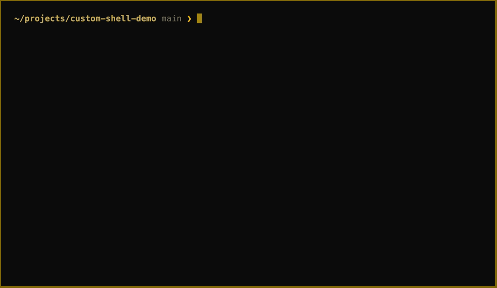

# custom-shell

[](https://github.com/shameworm/custom-shell/actions/workflows/ci.yml)
[](LICENSE)

A POSIX-style interactive shell written in TypeScript and running on [Bun](https://bun.com).

It runs builtins and external programs from your `PATH`, and handles:
- shell-style quoting and variables;
- pipelines and redirection;
- `&&` / `||` / `;` command lists;
- background jobs and command history;
- tab completion and Ctrl-C.



## Install

Download a standalone binary for macOS or Linux (x64 or arm64) from the [latest release](https://github.com/shameworm/custom-shell/releases/latest). It needs nothing else installed:

```bash
tar -xzf custom-shell-*.tar.gz
./custom-shell
```

On macOS, a binary downloaded with a browser is quarantined, and since it isn't notarized by Apple, macOS will say it can't verify the developer. Allow it once with `xattr -d com.apple.quarantine custom-shell`, or with **Open Anyway** in System Settings → Privacy & Security.

Or run it from source with Bun (see [Getting started](#getting-started)).

## Looks

On an interactive terminal, the prompt shows the current directory, the git branch, and an arrow that turns red after a failed command or Ctrl-C. Colours come from the [omarchy blackgold](https://github.com/HANCORE-linux/omarchy-blackgold-theme) palette: gold on near-black. Errors are shown in its red, and directories in completion lists in its gold.

With piped input, `NO_COLOR` set, or `TERM=dumb`, the shell prints exactly what bash would: a plain `$ ` prompt and uncoloured errors.

Below, the `$ ` prompt stands for the themed one.

```console
$ echo 'hello   world' "and \"quotes\""
hello   world and "quotes"
$ type echo
echo is a shell builtin
$ ls /nonexistent 2>> errors.txt
$ echo first > out.txt
$ echo second >> out.txt
$ cat out.txt
first
second
$ xyz_<TAB><TAB>
xyz_bar  xyz_baz  xyz_quz
$ xyz_
```

## Features

### Builtins

| Command | Description |
| --- | --- |
| `echo [args...]` | Print the arguments, separated by spaces |
| `pwd` | Print the current working directory |
| `cd [dir]` | Change directory; supports absolute and relative paths, `~` and `~/...` |
| `type <name>` | Say whether a name is a builtin or the path of an executable |
| `clear` | Clear the screen |
| `complete` | Manage programmable completion (see below) |
| `jobs` | List background jobs (see below) |
| `declare NAME=VALUE` / `declare -p [NAME]` | Set shell variables, or print them |
| `history [n]` | List previously run commands, or only the last `n` |
| `history -r/-w/-a <file>` | Read history from a file, write it to one, or append new entries |
| `exit` | Exit the shell |

Any other command is looked up in `PATH` and run as an external program. Unknown commands print `<name>: command not found`.

### Quoting and escaping

- **Single quotes** `'...'` keep everything literally.
- **Double quotes** `"..."` keep spaces; inside them, `\"` and `\\` are escapes.
- **Backslash** outside quotes escapes the next character (e.g. `\ ` for a literal space).
- Adjacent quoted and unquoted parts join into one argument: `'a'"b"c` → `abc`.

### Variables and expansion

`declare` sets shell variables, and `$NAME` or `${NAME}` expands to a variable's value:

```console
$ declare greeting=hello
$ declare -p greeting
declare -- greeting="hello"
$ echo $greeting ${greeting}world ${missing}world
hello helloworld world
$ declare 67=x
declare: `67=x': not a valid identifier
```

- Names start with a letter or `_`, followed by letters, digits and `_`.
- `${NAME}` marks where the name ends: `${greeting}world`, whereas `$greetingworld` is the variable `greetingworld`.
- Environment variables work too: `$HOME` expands, `declare -p HOME` shows `declare -x HOME="…"`, and `declare PATH=…` changes the `PATH` that commands are looked up in and that child processes see. Variables created with `declare` aren't passed to child processes.
- An unset variable expands to nothing.
- Quoting works as in bash:
  - nothing expands inside single quotes;
  - inside double quotes the value stays one word;
  - unquoted, it's split on whitespace into separate words;
  - `\$` gives a literal `$`.
- A malformed `${...}` is reported as `bad substitution` and the line isn't run.

### Redirection

| Operator | Effect |
| --- | --- |
| `>` / `1>` | Write stdout to a file (overwrite) |
| `>>` / `1>>` | Append stdout to a file |
| `2>` | Write stderr to a file (overwrite) |
| `2>>` | Append stderr to a file |

Target files are created when they don't exist. Redirection works for builtins and external programs alike, and stdout and stderr can be redirected in the same command.

### Command lists

Run several commands on one line, depending on whether the previous one succeeded:

| Syntax | Effect |
| --- | --- |
| `a ; b` | Run `a`, then `b` |
| `a && b` | Run `b` only if `a` succeeded (exit status 0) |
| `a \|\| b` | Run `b` only if `a` failed |
| `a & b` | Start `a` in the background, then run `b` |

```console
$ make && echo built || echo failed
$ sleep 2 && echo "Done sleeping" &
[1] 84470
```

- The whole line is checked before anything runs, so a syntax error anywhere means nothing on the line runs.
- Exit statuses follow bash:
  - a program's own exit code;
  - 128 + the signal number if a signal killed it;
  - 127 for an unknown command;
  - 1 for a builtin that reported an error;
  - a pipeline's status is its last command's.
- Operators don't need spaces around them (`a&&b`, `cat f|wc`, `echo hi>out`). Quoted or escaped operator characters are ordinary text.

### Pipelines

Separate commands with `|` to connect each one's output to the next one's input. Any number of commands can be chained, and builtins can appear anywhere:

```console
$ cat /tmp/foo/file | head -n 3 | wc
       3       3      10
$ echo apple-orange | wc
       1       1      13
$ ls | type exit
exit is a shell builtin
```

- All commands run at the same time, connected by real OS pipes, so `tail -f log | grep error` streams, and `yes | head -1` ends because `yes` gets `SIGPIPE`.
- The shell waits for every command to finish before showing the prompt.
- Each command can have its own redirects: `cat in.txt | sort > out.txt`.
- A builtin ignores its input. Whatever feeds it is cut off, which is why `ls` prints nothing above.

### Background jobs

End a command with `&` to run it in the background. The shell prints the job number and process ID and returns to the prompt right away. The job's output still goes to the terminal unless it is redirected.

```console
$ sleep 10 &
[1] 84470
$ sleep 20 &
[2] 84471
$ jobs
[1]-  Running                 sleep 10 &
[2]+  Running                 sleep 20 &
$ echo hello
hello
[1]-  Done                    sleep 10
$
```

- `+` marks the most recent job and `-` the one before it.
- A pipeline, an `&&`/`||` list or a builtin started with `&` runs in a subshell (a separate copy of the shell), so the whole thing is one job, and `cd dir &` doesn't change this shell's directory.
- Finished jobs are reported as `Done` once, either before the next prompt or by `jobs`, whichever comes first, and then removed.
- Job numbers are reused: a new job gets one more than the highest number still running, or `[1]` when there are none.

### History

Every command you enter is recorded, including invalid ones and `history` itself:

```console
$ echo hello
hello
$ invalid_command
invalid_command: command not found
$ history
    1  echo hello
    2  invalid_command
    3  history
$ history 2
    3  history
    4  history 2
```

History can be saved to and loaded from files:

| Command | Effect |
| --- | --- |
| `history -r <file>` | Append the file's commands to the history |
| `history -w <file>` | Write the whole history to the file, replacing it |
| `history -a <file>` | Append the commands not saved yet (by `-a` or `-w`) to the file |

If `HISTFILE` is set, the shell loads that file on startup, and on exit appends the commands from this session. Lines another session saved to the file in the meantime are kept.

```bash
HISTFILE=~/.custom_shell_history bun run dev
```

Press <kbd>↑</kbd> and <kbd>↓</kbd> to step through the same entries, and <kbd>Enter</kbd> to run the one shown. If you've typed something first, the arrows only step through entries that start with it.

### Tab completion

Press <kbd>Tab</kbd> to complete the word before the cursor:

- the **first word** is completed against builtins and executables in `PATH`;
- **any later word** is completed by the command's [completer script](#programmable-completion) if one is registered, and otherwise against files and directories, including nested paths like `src/utils/pa` and absolute paths. Dotfiles are only offered when the word starts with `.`.

What happens depends on how many entries match:

- **One match**: it is completed, followed by a space, or by `/` for a directory so you can keep going into it.
- **Several matches**: the word is extended to their longest common prefix (`xyz_` → `xyz_foo`).
- **Nothing more to add**: the first <kbd>Tab</kbd> rings the bell; a second <kbd>Tab</kbd> lists the matches alphabetically, with directories shown as `name/`.
- **No match**: rings the bell and leaves the input unchanged.

```console
$ cd proj<TAB>
$ cd project/
$ stat <TAB><TAB>
bar.txt  foo/
$ stat
```

### Programmable completion

`complete -C` registers a script that supplies completions for a command, as in bash:

```console
$ complete -C /path/to/git-completer git
$ complete -p git
complete -C '/path/to/git-completer' git
$ git che<TAB>
$ git checkout
$ complete -r git
```

| Usage | Effect |
| --- | --- |
| `complete -C <script> <name>...` | Register a completer script for each name |
| `complete -p [name...]` | Print the registered specs (all of them if no name is given) |
| `complete -r [name...]` | Remove specs (all of them if no name is given) |

When you press <kbd>Tab</kbd> on an argument of a registered command, the script is run with:

- `$1`: the command name, `$2`: the word being completed, `$3`: the word before it;
- `COMP_LINE`: the whole input line, and `COMP_POINT`: the cursor's byte offset in it.

Each line it prints is a candidate, and the usual rules apply: one candidate completes with a trailing space, several complete to their common prefix or are listed on a second <kbd>Tab</kbd>, and no output rings the bell. A script that can't be started, or runs for more than 5 seconds, gives no candidates.

### Ctrl-C

As in bash:
- **At the prompt:** <kbd>Ctrl</kbd>+<kbd>C</kbd> discards the line you were typing and gives you a fresh prompt.
- **While a command is running:** it stops that command (all of a pipeline), and the shell carries on.
- **Background jobs:** they aren't affected.

## Getting started

Requires [Bun](https://bun.com) 1.3 or later.

```bash
bun install
bun run dev        # start the shell
bun test           # run the test suite
bun run typecheck  # type-check with tsc
bun run build      # compile a standalone binary to dist/custom-shell
```

The demo GIF is recorded with [VHS](https://github.com/charmbracelet/vhs) from [`docs/demo.tape`](docs/demo.tape): run `vhs docs/demo.tape`.

### Releases

CI runs the type checker and tests on Linux and macOS for every push and pull request. Pushing a tag such as `v1.0.0` builds the binaries for all four platforms (the macOS ones ad-hoc signed) and publishes them, with SHA-256 checksums, as a GitHub release.

## Project structure

```
app/
├── main.ts              # REPL loop: prompt, parse, redirect, dispatch
├── builtins.ts          # builtin commands
├── commandList.ts       # ;, &&, || and & lists: parsing and running
├── complete.ts          # complete builtin and completer-script runner
├── execute.ts           # runs one command; exit statuses; background jobs
├── history.ts           # command history and the history builtin
├── jobs.ts              # background job table and jobs output
├── pipeline.ts          # runs | pipelines of builtins and external commands
├── theme.ts             # blackgold colours and the prompt
├── subshell.ts          # starts and runs background lists in a subshell
├── variables.ts         # shell variables and the declare builtin
└── utils/
    ├── parseArgs.ts     # tokenizer: quotes, escapes and $VAR expansion
    ├── redirect.ts      # parses >, >>, 1>, 1>>, 2>, 2>>
    ├── osPipe.ts        # creates real OS pipes (via a named pipe)
    ├── pathUtils.ts     # PATH lookup, executable search, cd
    └── completer.ts     # tab completion: commands, scripts, files, directories
test/                    # unit tests (bun test)
```

## License

[MIT](LICENSE)
